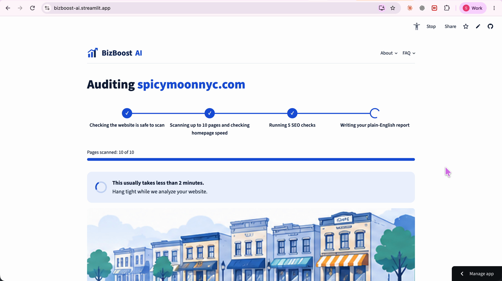
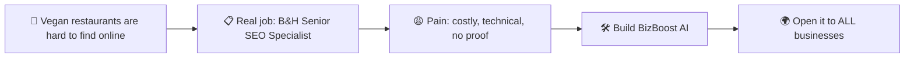
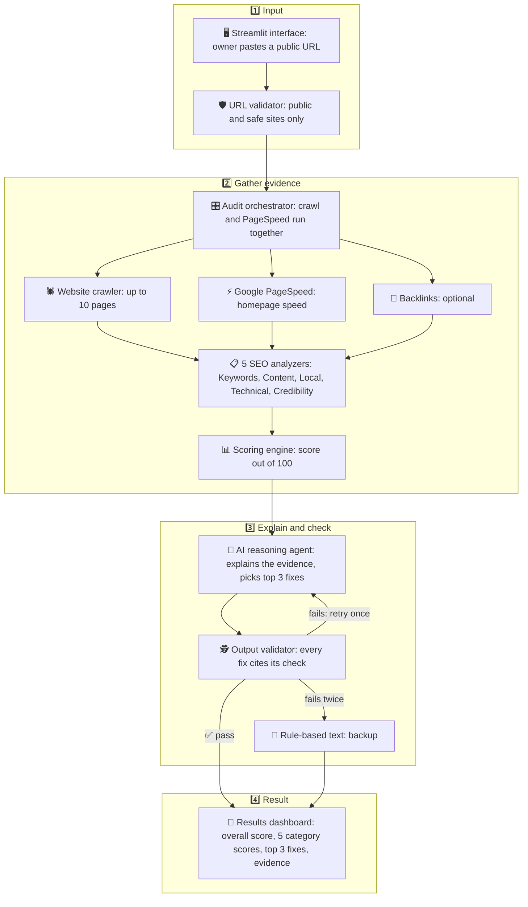
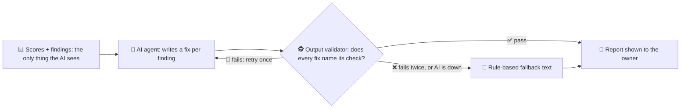

<div align="center">

# 🚀📈 BizBoost AI

### *A free website check-up that shows any business how to get found on Google, in plain English.*

**Type in your website address. In under 2 minutes, get your scores, the proof behind them, and the 3 things to fix first.** ⏱️


<sub>🎨 Design preview of the new front end. Scores shown are sample data.</sub>

### 🎬 Watch the demo (1.5 min)

[](presentation/Screen%20Recording%206.03.20%20cut-1m26.mp4)

<sub>▶️ Click the picture to play the screen recording.</sub>

### 🌐 Try the live app: **[bizboost-ai.streamlit.app](https://bizboost-ai.streamlit.app/)**

</div>

---

## 📚 Table of contents

- [📋 1. The job: B&H Senior SEO Specialist, and its pain points](#-1-the-job-bh-senior-seo-specialist-and-its-pain-points)
- [🛠️ 2. What we built to take those pain points away](#️-2-what-we-built-to-take-those-pain-points-away)
- [🏗️ 3. The agent architecture and build flow](#️-3-the-agent-architecture-and-build-flow)
- [🔁 4. The small loop: the AI can't make things up](#-4-the-small-loop-the-ai-cant-make-things-up)
- [🧪 Did it work?](#-did-it-work)
- [✅ What works today (and what doesn't yet)](#-what-works-today-and-what-doesnt-yet)
- [🙌 Who did what](#-who-did-what)
- [🚀 Try it yourself](#-try-it-yourself)
- [🛠️ For developers](#️-for-developers)

---

## 📋 1. The job: B&H Senior SEO Specialist, and its pain points

We started from a **real job description**: the **Senior SEO Specialist at B&H**. 🧑‍💼 It's the person big companies pay full-time to check a website, work out what's wrong, and decide what to fix first.

### 🧰 One job, six kinds of work

| 🗂️ Area of the job | 📝 What B&H pays them to do |
| --- | --- |
| 🔍 **Audits** | Recurring technical and on-page audits |
| 📡 **Monitoring** | Crawlability, speed, XML sitemaps, canonicals, metadata, redirects |
| 🔑 **Keywords** | Keyword research and knowing the ranking factors |
| ✍️ **Content** | Requesting new or refreshed content and landing-page changes |
| 🔗 **Links** | Link building and interlinking |
| 🎯 **Priorities** | Choosing projects from data and reporting status |

### 😩 The pain points

That is **too big a job for a small business**. 🏪

- 💸 **Too expensive.** A full-time specialist or an agency costs a lot. Even an SEO tool starts around **$129/month** (Semrush's entry plan). 
- 🤯 **Too technical.** Those tools are built for marketers, so owners can't turn the output into action.
- 🤷 **Nobody tells you.** Owners guess, pay an agency, or do nothing.
- 🤨 **Hard to trust.** Owners burned by agencies don't want a score with no proof.

> 🥗 **Example:** a vegan restaurant in New York with no page titles, summaries or photo descriptions never shows up for *"vegan food near me"*, and the owner has no idea. 😢



---

## 🛠️ 2. What we built to take those pain points away

**BizBoost AI is the SEO specialist that small businesses can afford.** 🦸

> 🌐 **Enter your website** → 🔍 **We check 5 areas** → 📊 **You get scores and proof** → ✅ **You get your top 3 fixes**

No account. No SEO knowledge. No paid tools. Free, in under 2 minutes. ⏱️

### 🎯 Five areas, one score each (out of 100)

Each part of the specialist's job became a checklist. The overall score is a **weighted average**.

| Weight | 🧩 Area | ❓ The question it answers | 👔 Replaces in the job |
| :---: | --- | --- | --- |
| 25% | 🔑 **Keywords** | Do your pages use the words customers search for? | Keyword research and ranking factors |
| 20% | 📝 **Content quality** | Is your writing useful and complete? | Content and landing-page requests |
| 20% | 📍 **Local presence** | Can Google find your address, phone and hours? | *Added for small businesses* |
| 25% | ⚙️ **Technical health** | Are there broken pieces? Is the site fast? | Audits and monitoring |
| 10% | 🏅 **Credibility** | Do other websites link to you and vouch for you? | Link building and interlinking |

> 🎯 The weights are a first guess, tuned after our 10 test sites. Checks we can't reach are **dropped** and the other weights rescale to 100, so nobody is penalized for missing data. 🙈

### 💔 Pain point → ✅ What we did

| 😩 Pain point | 🛠️ How BizBoost AI fixes it |
| --- | --- |
| 💸 Too expensive | Free. No account, no paid tools. |
| ⏳ Audits take hours | Results in under 2 minutes. |
| 🤯 Too technical | An AI turns jargon into plain English. |
| 🧾 No proof | Every finding shows what was found and on which page. |
| 🤷 Don't know where to start | An ordered **top 3 fixes** list. |
| 🤝 Can't hand it to a designer | A downloadable report with no SEO talk. |

### 😊 What every finding looks like

| 🔍 What we found | 💡 Why it matters | ✅ What to do |
| --- | --- | --- |
| 12 of 14 photos on the homepage have no description | Search engines can't tell what the photos show | Add a short description to each photo, such as the name of the dish |

*(A real example from one of our 10 test sites.)*

### 🎬 Scope

- 🌐 **Website optimization:** technical SEO, keywords, content, local SEO, credibility.
- 📱 **Social media:** not measured yet. A feature we can add later.

> 🙋 **One honest limit:** it only looks at public information and up to 10 pages. It's a great starting check-up, not a replacement for a long-term SEO plan.

---

## 🏗️ 3. The agent architecture and build flow

**Code decides, AI explains.** 🔑 The checklists decide what is wrong. The AI only explains it, and is never allowed to decide on its own that a problem exists.



### 🧭 The flow, step by step

| Step | 🧱 Part | 🎯 Job |
| :---: | --- | --- |
| 1️⃣ | 🖥️ **Streamlit interface** | The owner pastes a public URL |
| 1️⃣ | 🛡️ **URL validator** | Only public, safe sites. Never private IPs, localhost or unsafe redirects |
| 2️⃣ | 🎛️ **Audit orchestrator** | Runs the crawl and the speed test at the same time |
| 2️⃣ | 🕷️ **Website crawler** | Reads up to 10 pages, homepage first, respecting `robots.txt` |
| 2️⃣ | ⚡ **Google PageSpeed** | Tests homepage speed (30-second limit) |
| 2️⃣ | 🔗 **Backlinks (optional)** | Inbound link data. Never fails a site |
| 2️⃣ | 📋 **5 SEO analyzers** | Keywords, Content, Local, Technical, Credibility |
| 2️⃣ | 📊 **Scoring engine** | Turns checks into a score out of 100 |
| 3️⃣ | 🤖 **AI reasoning agent** | Explains the evidence and picks the top 3 fixes |
| 3️⃣ | 🕵️ **Output validator** | Checks every fix names a real check |
| 3️⃣ | 🧰 **Rule-based text** | Backup if the AI fails twice or is down |
| 4️⃣ | 📄 **Results dashboard** | Overall score, 5 category scores, top 3 fixes, evidence for each |

### 📊 How the score works

- ✅ A check that **passes** earns a full point, ⚠️ one that **needs attention** earns half, and ❌ one that **fails** earns none.
- 🙈 A check we **couldn't measure** is **left out**. It is never counted as zero.
- 📈 The overall score combines the five areas using the weights above.

---

## 🔁 4. The small loop: the AI can't make things up

This is the safety heart of the build. 💓 The AI can only see the scanner's list of findings, never the raw website, and every answer is **marked like homework** before it reaches you. 🧑‍🏫



### 📜 The rules

- 🧾 **Explain only what the evidence shows.**
- 🏷️ **Every recommendation names its check.**
- 🚫 **No invented metrics, rankings or traffic.** If a number isn't in the evidence, the explanation is rejected.
- 🔁 **Only one retry,** then the backup text takes over, and the report says it wasn't written by the AI.
- 🧰 **The app still works if the AI is down.** You always get your scores and findings.
- 🙈 **Can't check it? We say so.** "Data unavailable" is never counted against you.
- 🔒 **Nothing is saved.** Your address and results disappear when you close the page.

🎯 **Goal: 0 unsupported recommendations.**

---

## 🧪 Did it work?

We ran BizBoost AI on **10 real public restaurant websites**, then **read every AI explanation by hand** and compared it to the scanner's proof. 🔬

| 🎯 What we wanted | ✅ What we found |
| --- | --- |
| At least 9 of 10 audits finish | 🎉 **10 of 10** |
| Under 2 minutes each | ⏱️ **Every test run finished in under 2 minutes** (the longest about 70 seconds) |
| Proof behind every finding | 🧾 **100%** |
| No AI claims that aren't in the proof | 🛡️ **0 found** in our review |

### 📈 The scores (average about 82)

| Site | Score | Site | Score |
| --- | :---: | --- | :---: |
| 🥇 Kailash Parbat | **91** | Jajaja | 84 |
| Coletta | 89 | Bodhi | 81 |
| Natural Blend | 88 | Ahimsa | 81 |
| Next Level Vegan | 87 | Sen Saigon | 75 |
| Slutty Vegan | 73 | Spicy Moon | 69 |

🐛 **Testing also found real bugs, and we fixed them:** some AI wording went beyond the proof, and the readability check gave a wrong result on menu-style pages.

📖 Read the full review: [`review/ai-review-10-sites.md`](review/ai-review-10-sites.md) (also as a [PDF](review/ai-review-10-sites.pdf)).

---

## ✅ What works today (and what doesn't yet)

We want to be honest about where we are. 🙌

**🟢 Working**

- The full check-up, from website address to scores, proof and top 3 fixes.
- Plain-English explanations from the Claude AI, with the check-and-retry safety loop.
- A backup mode that works even if the AI is unavailable.
- Honest handling of anything we can't read ("Data unavailable").
- A downloadable report you can send to your web designer.
- Automated tests that pass.

**🟡 Still a work in progress**

- 🎨 The **new front end** (the design at the top of this page) is being built by Erick. The app works today with a simpler screen.
- 🙋 We haven't yet tested with **real business owners**. Our goal: 4 out of 5 can name their top fix without any help.
- 🔍 It only reads **public information** and **up to 10 pages**.
- 🧱 Pages built in a way our scan can't read show "Data unavailable".
- 🔗 Link data (who links to you) is **optional and incomplete**, so it never fails a site.
- ⚡ Speed results can change a little from one run to the next.
- 🔬 Our review shows the AI text matched the proof on 10 sites. That's a strong sign, not a guarantee for every website.

---

## 🙌 Who did what

Two builders, one team. 💪 Say hello! 👋

<table>
  <tr>
    <td align="center" width="50%" valign="top">
      
      <h3>Soma Majumder</h3>
      <p>🎊 Drop by and say hello! Always happy to chat!</p>
      <p>
        <a href="https://github.com/Soma-Majumder">🐙 GitHub</a> &nbsp;|&nbsp;
        <a href="https://www.linkedin.com/in/somamajumder/">💼 LinkedIn</a>
      </p>
    </td>
    <td align="center" width="50%" valign="top">
      
      <h3>Erick Marcatoma</h3>
      <p>🎊 Drop by and say hello! Always happy to chat!</p>
      <p>
        <a href="https://github.com/erickmarcatoma">🐙 GitHub</a> &nbsp;|&nbsp;
        <a href="https://www.linkedin.com/in/erick-marcatoma-611326419/">💼 LinkedIn</a>
      </p>
    </td>
  </tr>
</table>

Here's how the work was shared, based on our project history.

### 🔧 Soma Majumder, *the Checker and Explainer Builder* 🧠

Soma built the parts that look at a website, score it, and explain it in plain English.

- 📋 **Wrote the plan:** the product requirements and the design of how the AI and the checklists work together.
- 🕷️ **Built the website reader** that visits up to 10 pages.
- 📋 **Built the five checklists** for keywords, content, local presence, technical health and credibility.
- ⚡ **Connected Google's speed test** and the optional link-data service.
- 📊 **Built the scoring** that turns checks into honest scores.
- 🤖 **Built the Claude AI helper** that explains problems and picks the top 3 fixes.
- 😊 **Made the explanations friendly:** every finding is now *what we found, why it matters, what to do*, with emojis.
- 🔬 **Ran and reviewed the 10-site test,** and fixed the bugs it found.
- 🎤 **Built the presentation** and prepared the demo.

### 🎨 Erick Marcatoma, *the Flow and Look Builder* 🖥️

Erick built the parts that tie everything together and the way people see it.

- 🗺️ **Wrote the project plan,** the assumptions, and the early README.
- 🎛️ **Built the audit runner** that takes one website from address to results.
- 🛡️ **Built the safety check and the backup text,** so only proven explanations reach the report, and the app works even if the AI doesn't.
- 📄 **Built the report and the results screen.**
- 🧪 **Wrote the end-to-end tests** that check a whole audit from start to finish.
- 🎨 **Designed the new front end:** the landing page, the progress screen and the report screen.

### 🤝 Together

- 🌱 Spotted the problem and shaped the idea.
- 🔍 Reviewed each other's work before it was merged.
- 🧭 Chose to keep the app simple: one AI helper, five checklists, and honest limits.

---

## 🚀 Try it yourself

You'll need a computer with **Python 3.10 or newer**. 🐍

### 1️⃣ Get the code

```bash
git clone https://github.com/Soma-Majumder/BizBoost-AI.git
cd BizBoost-AI
python -m venv .venv
source .venv/bin/activate        # Windows: .venv\Scripts\activate
pip install -r requirements.txt
```

### 2️⃣ Add your keys 🔑

Copy `.env.example` to `.env` in the project folder and fill it in. **Never share or commit `.env`.**

```
ANTHROPIC_API_KEY=your_claude_key        # for the plain-English AI
PAGESPEED_API_KEY=your_google_speed_key  # for the speed check
ANTHROPIC_MODEL=claude-sonnet-5-5
BACKLINK_API_KEY=your_crawly_key         # optional
```

| 🔑 Key | What happens without it |
| --- | --- |
| Claude key | The app still works, and shows standard explanations instead of AI-written ones |
| Google speed key | The speed checks say "Data unavailable" |
| Link-data key (optional) | Link checks say "Data unavailable" |

### 3️⃣ Start the app ▶️

```bash
streamlit run app.py
```

Open the address it prints (usually http://localhost:8501), type in a website, and click **Start Audit**. 🎉

### 🧪 Run the checks

```bash
pip install pytest
python -m pytest -q
```

### 🆘 "AI explanations are unavailable right now"

Look at the terminal where the app is running. If it says the key was rejected, you may have an **old key saved in your computer's settings** (for example in `~/.zshrc`). An old key there takes priority over the one in `.env`. Remove or update the old one, open a new terminal, and start the app again.

---

## 🛠️ For developers

<details>
<summary>🧰 Tech stack</summary>

- **Python** and **Streamlit** for the app and results screen
- **BeautifulSoup** for reading pages
- **Google PageSpeed Insights API** for homepage speed
- **Claude API (Anthropic)** for the plain-English explanations (default model: `claude-sonnet-5-5`)
- **Crawly API** (optional) for link data, free key with 100 requests a day

</details>

<details>
<summary>📏 Rules the system follows</summary>

| Rule | What it means |
| --- | --- |
| Public data only | No Google Analytics, no Search Console, no accounts. |
| Crawler safety | Never scans private IP addresses, localhost, or unsafe redirects. |
| Respect site rules | Checks `robots.txt`, uses reasonable crawl limits, and identifies its crawler. |
| Evidence first | Every finding links to a measurable check or a named data source. |
| No invented data | Missing link data stays "unavailable", never zero. |
| Honest scoring | Unavailable checks are dropped and the remaining weights rescale to 100. |
| Small crawl | Up to 10 pages: homepage first, then the sitemap, then links from the homepage. |
| Speed check scope | Homepage only, run alongside the crawl, with a 30-second timeout. |
| JavaScript-heavy sites | The crawler reads the HTML the server sends. Content built by JavaScript shows "Data unavailable". |
| Nothing stored | The address, pages, findings and report live in memory only while the results are on screen. |

Two outside services receive data: Google PageSpeed gets the homepage address, and the Claude API gets the findings and scores as text (never the raw page).

</details>

<details>
<summary>🗓️ Build plan and open questions</summary>

| Dates (2026) | Work | Deliverable |
| --- | --- | --- |
| Nov 4–5 | Streamlit interface, URL validation, crawler | Website scanner |
| Nov 6–7 | Five analyzers, PageSpeed, scoring | Evidence-based scores |
| Nov 8 | Audit orchestrator | URL to scores |
| Nov 9–10 | Claude explanations, top 3 fixes, results screen | AI-powered audit |
| Nov 11 | Test on 10 sites, fix bugs | Demo-ready build |
| Nov 12 | Demo | Working demo |

- Still to do before the demo: compare Claude Sonnet 5.5 with Claude Opus 5.5 on a few test sites, and switch only if Sonnet makes claims the evidence can't back up.
- Open question: how should local SEO be handled for businesses where local search doesn't matter?

</details>

---

## 📎 Learn more

- 📄 [Product requirements (PRD)](docs/BizBoost-AI-PRD.md)
- 🏗️ [How the AI and the checklists work together](docs/BizBoost-AI-Agent-Architecture.md)
- 🔬 [Our review of 10 real websites](review/ai-review-10-sites.md)
- 🗺️ [Project plan](BizBoost%20AI%20%E2%80%94%20Project%20plan.md)

<div align="center">

Made with 💙 to help great local businesses get found. 🌱

</div>
