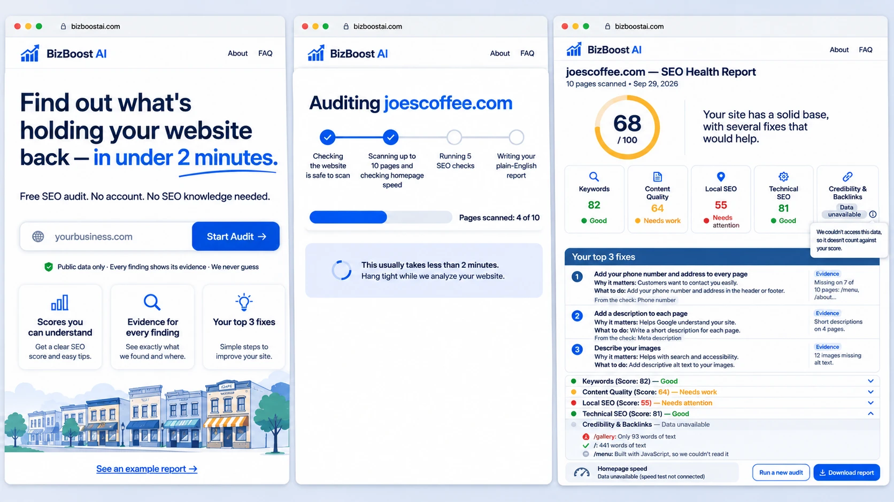
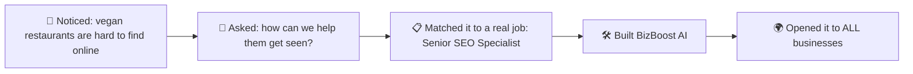
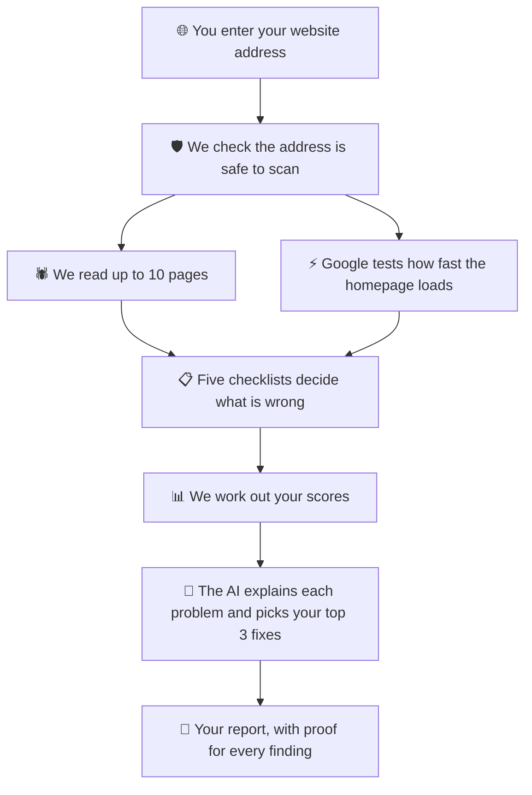
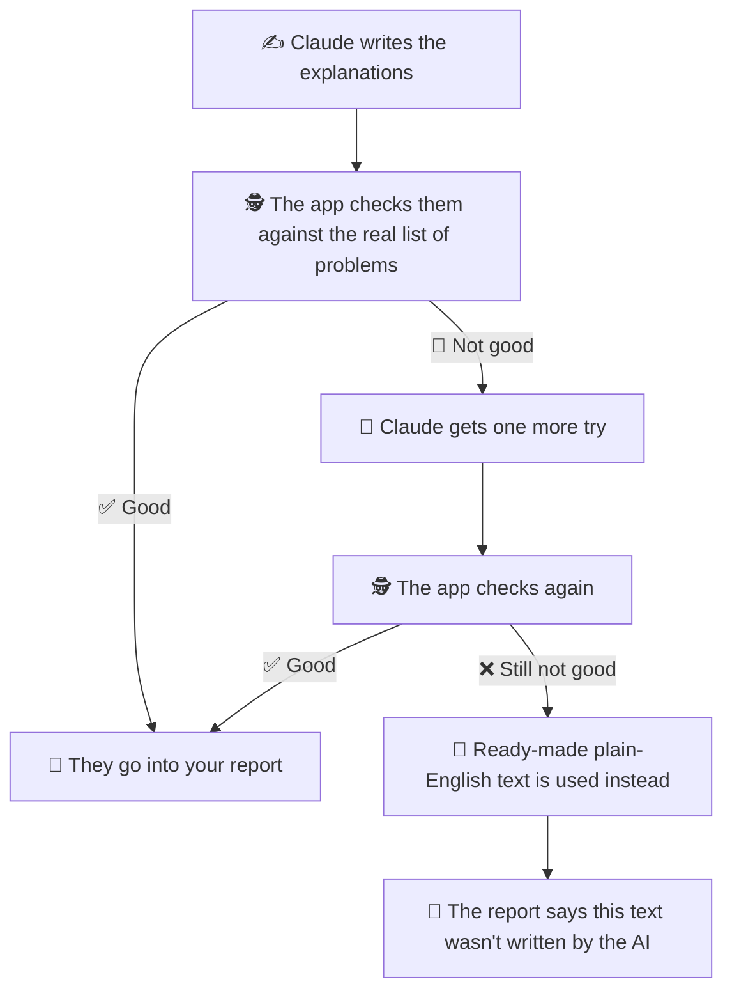

<div align="center">

# 🚀📈 BizBoost AI

### *A free website check-up that shows any business how to get found on Google, in plain English.*

**Type in your website address. In under 2 minutes, get your scores, the proof behind them, and the 3 things to fix first.** ⏱️




<sub>🎨 Design preview of the new front end. Scores shown are sample data.</sub>

</div>

---

## 📚 Table of contents

- [😩 The problem](#-the-problem)
- [🔍 How we came upon BizBoost AI](#-how-we-came-upon-bizboost-ai)
- [💡 Our idea](#-our-idea)
- [🎯 Who is this for?](#-who-is-this-for)
- [✨ What BizBoost AI does](#-what-bizboost-ai-does)
- [🧠 How it works](#-how-it-works)
- [🤖 How the AI helps (and how we keep it honest)](#-how-the-ai-helps-and-how-we-keep-it-honest)
- [📊 How the score works](#-how-the-score-works)
- [🧩 Problems we hit, and what we decided](#-problems-we-hit-and-what-we-decided)
- [🧪 Did it work?](#-did-it-work)
- [✅ What works today (and what doesn't yet)](#-what-works-today-and-what-doesnt-yet)
- [🙌 Who did what](#-who-did-what)
- [🚀 Try it yourself](#-try-it-yourself)
- [🛠️ For developers](#️-for-developers)

---

## 😩 The problem

Picture a small vegan restaurant in New York. The food is great and the owner is proud of the website. 🌱

- 🔎 But when someone nearby searches Google for **"vegan food near me"**, the restaurant **doesn't show up**.
- 🧩 Behind the scenes, the website is **missing the basics Google looks for**, like page titles, short summaries and photo descriptions.
- 🤷 The owner **has no idea**, because nobody ever told them.
- 💸 Finding out normally means paying an agency or a full-time **SEO specialist**.

> 💬 **SEO** just means making your website easy for Google to find and understand.

The result: hungry people in the larger NYC community **can't find these restaurants**, and the restaurants lose customers they never knew they had. 😢

---

## 🔍 How we came upon BizBoost AI

Most projects start with a job description. **Ours started with something we noticed.** 👀

1. 🥗 **We noticed a pattern.** A lot of vegan restaurants in New York were not SEO optimized, and the wider community couldn't find them.
2. 🤔 **We asked how we could help.** Could we put **more eyeballs** on these restaurants?
3. 📋 **Then we found the job behind the problem.** Our teacher asked us to start from a real job description. Ours was the **Senior SEO Specialist** role at B&H, the person big companies pay full-time to check websites, work out what's wrong, and decide what to fix first.
4. 💡 **We turned that job into a tool.** What if a small business could get the same kind of check-up in minutes, for free?
5. 🌍 **We opened it up to everyone.** We started with vegan restaurants, but the checks work for **any business with a website**. So BizBoost AI is now open to **ALL businesses**. 🎉



---

## 💡 Our idea

**BizBoost AI is the SEO specialist that small businesses can't afford.** 🦸

It reads your website the way Google does, finds what's holding you back, and explains it simply:

> 🌐 **Enter your website** → 🔍 **We check 5 areas** → 📊 **You get scores and proof** → ✅ **You get your top 3 fixes**

No account. No SEO knowledge. No paid tools. ✨

---

## 🎯 Who is this for?

| 🙋 Who | 💖 How BizBoost AI helps |
| --- | --- |
| **Small-business owners** (cafés, restaurants, shops, salons) | Shows whether people can find them on Google, and what to fix first |
| **Busy owners with no time to learn SEO** | Picks the top 3 fixes so they know where to spend their first free hour |
| **Owners who've been burned by agencies** | Shows the proof behind every finding, so it never feels like a sales pitch |
| **Owners who pay a web designer** | Gives a clear report to send, so the designer knows exactly what to fix |
| **Freelance marketers and designers** | A quick, evidence-based check-up to share with a client |

---

## ✨ What BizBoost AI does

Normally, someone has to click through your website page by page, look for problems, work out what matters, and write it all up. **BizBoost AI does that automatically:**

1. 🌐 **Visits your website.** It reads up to 10 pages, the way Google does, and respects each site's rules about what robots may read.
2. 🔍 **Checks five areas:**
   - 🔑 **Keywords:** do your pages use the words customers actually search for?
   - 📝 **Content quality:** is your writing useful and complete?
   - 📍 **Local presence:** can Google easily find your address, phone number and hours? This matters for "near me" searches.
   - ⚙️ **Technical health:** are there broken pieces? Is the site fast?
   - 🏅 **Credibility:** do other websites link to you and vouch for you?
3. 📊 **Gives you scores.** One overall score out of 100, plus a score for each area.
4. 🧾 **Shows proof.** Every problem says what was found and on which page.
5. 🗣️ **Explains in plain English.** An AI assistant turns the technical findings into simple words.
6. 🥇 **Picks your top 3 fixes,** in order, so you know where to start.
7. 🙈 **Says so when it can't check something.** It shows **"Data unavailable"** instead of guessing or giving you a false failing grade.

### 😊 What every finding looks like

Each problem in your report comes in three simple parts:

| 🔍 What we found | 💡 Why it matters | ✅ What to do |
| --- | --- | --- |
| 12 of 14 photos on the homepage have no description | Search engines can't tell what the photos show | Add a short description to each photo, such as the name of the dish |

*(A real example from one of our 10 test sites.)*

### 💰 How it helps a business

- 💵 **Saves money.** An expert-style check-up without an agency or a full-time specialist.
- ⏳ **Saves time.** Results in minutes. A manual audit takes hours.
- 🍽️ **Brings in more customers.** If Google can't read your site, nearby customers find your competitor instead.
- 🥇 **Tells you what to do first.** The top 3 list puts the fixes that matter most first.
- 🤝 **Builds trust.** You can see the evidence behind every finding.
- 📤 **Easy to hand off.** Send the report to your web designer. No SEO talk needed.

> 🙋 **One honest limit:** it only looks at public information and up to 10 pages. It's a great starting check-up, not a replacement for a long-term SEO plan.

---

## 🧠 How it works

BizBoost AI is **five checklists and one AI helper**. 🧰



**The key idea:** 🔑 the **checklists decide what is wrong**. The **AI only explains it.** The AI is never allowed to decide on its own that a problem exists.

---

## 🤖 How the AI helps (and how we keep it honest)

Technical findings sound like this: *"Meta description tag is missing."* 😵 Most owners don't know what that means.

That's where the **Claude API** comes in. It turns those findings into plain language a business owner can understand, without any jargon. We send Claude the list of real problems **once**, and it explains each one and picks the top 3 fixes.

### 🔁 The "teacher marking homework" loop



### 🛡️ Safety rules we built in

- 🚫 **The AI can't invent problems.** It only sees the scanner's list of findings, never the raw website.
- 🔢 **No made-up numbers.** If a number isn't in the evidence, the explanation is rejected.
- 🔁 **Only one retry,** and then the backup text takes over.
- 🧰 **The app still works if the AI is down.** You always get your scores and findings.
- 🙈 **Can't check it? We say so.** "Data unavailable" is never counted against you.
- 🔒 **Nothing is saved.** Your address and results disappear when you close the page.

---

## 📊 How the score works

- ✅ A check that **passes** earns a full point, ⚠️ one that **needs attention** earns half, and ❌ one that **fails** earns none.
- 🙈 A check we **couldn't measure** is **left out**. It is never counted as zero.
- 📈 Each of the five areas gets a score out of 100. Your **overall score** combines them, and areas that matter most count for more:

| Area | Counts for |
| --- | --- |
| ⚙️ Technical health | 25% |
| 🔑 Keywords | 25% |
| 📝 Content quality | 20% |
| 📍 Local presence | 20% |
| 🏅 Credibility | 10% |

> 🎯 These percentages are our first guess. We tuned our thinking after testing 10 real sites, and they can change as we learn more.

---

## 🧩 Problems we hit, and what we decided

| 😬 Problem | 💡 What we decided |
| --- | --- |
| An AI can say things that aren't true. | The checklists decide what's wrong. The AI only explains it. |
| The AI might mention something the scan never found. | Every explanation is checked against the real list. If it fails, Claude gets one more try. |
| The AI service might be down. | The report falls back to ready-made plain-English text and says so. |
| Some pages are built in a way our scan can't read. | Those checks say "Data unavailable" and are left out of the score. |
| Owners don't understand SEO words. | Every finding is *what we found, why it matters, what to do*, with no jargon. |
| Owners who were burned by agencies don't trust a score. | Every finding shows its proof: what was found, and on which page. |
| Speed tests and link data can be slow or incomplete. | We test the homepage only, with a time limit. Link data is optional and never fails a site. |
| Checking a whole website would take too long. | We read up to 10 pages, homepage first. |

---

## 🧪 Did it work?

We ran BizBoost AI on **10 real public restaurant websites**, then **read every AI explanation by hand** and compared it to the scanner's proof. 🔬

| 🎯 What we wanted | ✅ What we found |
| --- | --- |
| At least 9 of 10 audits finish | 🎉 **10 of 10** |
| Under 2 minutes each | ⏱️ **Every test run finished in under 2 minutes** (the longest about 70 seconds) |
| Proof behind every finding | 🧾 **100%** |
| No AI claims that aren't in the proof | 🛡️ **0 found** in our review |

### 📈 The scores (average about 82)

| Site | Score | Site | Score |
| --- | :---: | --- | :---: |
| 🥇 Kailash Parbat | **91** | Jajaja | 84 |
| Coletta | 89 | Bodhi | 81 |
| Natural Blend | 88 | Ahimsa | 81 |
| Next Level Vegan | 87 | Sen Saigon | 75 |
| Slutty Vegan | 73 | Spicy Moon | 69 |

🐛 **Testing also found real bugs, and we fixed them:** some AI wording went beyond the proof, and the readability check gave a wrong result on menu-style pages.

📖 Read the full review: [`review/ai-review-10-sites.md`](review/ai-review-10-sites.md) (also as a [PDF](review/ai-review-10-sites.pdf)).

---

## ✅ What works today (and what doesn't yet)

We want to be honest about where we are. 🙌

**🟢 Working**

- The full check-up, from website address to scores, proof and top 3 fixes.
- Plain-English explanations from the Claude AI, with the check-and-retry safety loop.
- A backup mode that works even if the AI is unavailable.
- Honest handling of anything we can't read ("Data unavailable").
- A downloadable report you can send to your web designer.
- Automated tests that pass.

**🟡 Still a work in progress**

- 🎨 The **new front end** (the design at the top of this page) is being built by Erick. The app works today with a simpler screen.
- 🙋 We haven't yet tested with **real business owners**. Our goal: 4 out of 5 can name their top fix without any help.
- 🔍 It only reads **public information** and **up to 10 pages**.
- 🧱 Pages built in a way our scan can't read show "Data unavailable".
- 🔗 Link data (who links to you) is **optional and incomplete**, so it never fails a site.
- ⚡ Speed results can change a little from one run to the next.
- 🔬 Our review shows the AI text matched the proof on 10 sites. That's a strong sign, not a guarantee for every website.

---

## 🙌 Who did what

Two builders, one team. 💪 Say hello! 👋

<table>
  <tr>
    <td align="center" width="50%" valign="top">
      
      <h3>Soma Majumder</h3>
      <p>🎊 Drop by and say hello! Always happy to chat!</p>
      <p>
        <a href="https://github.com/Soma-Majumder">🐙 GitHub</a> &nbsp;|&nbsp;
        <a href="https://www.linkedin.com/in/somamajumder/">💼 LinkedIn</a>
      </p>
    </td>
    <td align="center" width="50%" valign="top">
      
      <h3>Erick Marcatoma</h3>
      <p>🎊 Drop by and say hello! Always happy to chat!</p>
      <p>
        <a href="https://github.com/erickmarcatoma">🐙 GitHub</a> &nbsp;|&nbsp;
        <a href="https://www.linkedin.com/in/erick-marcatoma-611326419/">💼 LinkedIn</a>
      </p>
    </td>
  </tr>
</table>

Here's how the work was shared, based on our project history.

### 🔧 Soma Majumder, *the Checker and Explainer Builder* 🧠

Soma built the parts that look at a website, score it, and explain it in plain English.

- 📋 **Wrote the plan:** the product requirements and the design of how the AI and the checklists work together.
- 🕷️ **Built the website reader** that visits up to 10 pages.
- 📋 **Built the five checklists** for keywords, content, local presence, technical health and credibility.
- ⚡ **Connected Google's speed test** and the optional link-data service.
- 📊 **Built the scoring** that turns checks into honest scores.
- 🤖 **Built the Claude AI helper** that explains problems and picks the top 3 fixes.
- 😊 **Made the explanations friendly:** every finding is now *what we found, why it matters, what to do*, with emojis.
- 🔬 **Ran and reviewed the 10-site test,** and fixed the bugs it found.
- 🎤 **Built the presentation** and prepared the demo.

### 🎨 Erick Marcatoma, *the Flow and Look Builder* 🖥️

Erick built the parts that tie everything together and the way people see it.

- 🗺️ **Wrote the project plan,** the assumptions, and the early README.
- 🎛️ **Built the audit runner** that takes one website from address to results.
- 🛡️ **Built the safety check and the backup text,** so only proven explanations reach the report, and the app works even if the AI doesn't.
- 📄 **Built the report and the results screen.**
- 🧪 **Wrote the end-to-end tests** that check a whole audit from start to finish.
- 🎨 **Designed the new front end:** the landing page, the progress screen and the report screen.

### 🤝 Together

- 🌱 Spotted the problem and shaped the idea.
- 🔍 Reviewed each other's work before it was merged.
- 🧭 Chose to keep the app simple: one AI helper, five checklists, and honest limits.

---

## 🚀 Try it yourself

You'll need a computer with **Python 3.10 or newer**. 🐍

### 1️⃣ Get the code

```bash
git clone https://github.com/Soma-Majumder/BizBoost-AI.git
cd BizBoost-AI
python -m venv .venv
source .venv/bin/activate        # Windows: .venv\Scripts\activate
pip install -r requirements.txt
```

### 2️⃣ Add your keys 🔑

Copy `.env.example` to `.env` in the project folder and fill it in. **Never share or commit `.env`.**

```
ANTHROPIC_API_KEY=your_claude_key        # for the plain-English AI
PAGESPEED_API_KEY=your_google_speed_key  # for the speed check
ANTHROPIC_MODEL=claude-sonnet-5-5
BACKLINK_API_KEY=your_crawly_key         # optional
```

| 🔑 Key | What happens without it |
| --- | --- |
| Claude key | The app still works, and shows standard explanations instead of AI-written ones |
| Google speed key | The speed checks say "Data unavailable" |
| Link-data key (optional) | Link checks say "Data unavailable" |

### 3️⃣ Start the app ▶️

```bash
streamlit run app.py
```

Open the address it prints (usually http://localhost:8501), type in a website, and click **Start Audit**. 🎉

### 🧪 Run the checks

```bash
pip install pytest
python -m pytest -q
```

### 🆘 "AI explanations are unavailable right now"

Look at the terminal where the app is running. If it says the key was rejected, you may have an **old key saved in your computer's settings** (for example in `~/.zshrc`). An old key there takes priority over the one in `.env`. Remove or update the old one, open a new terminal, and start the app again.

---

## 🛠️ For developers

<details>
<summary>🧰 Tech stack</summary>

- **Python** and **Streamlit** for the app and results screen
- **BeautifulSoup** for reading pages
- **Google PageSpeed Insights API** for homepage speed
- **Claude API (Anthropic)** for the plain-English explanations (default model: `claude-sonnet-5-5`)
- **Crawly API** (optional) for link data, free key with 100 requests a day

</details>

<details>
<summary>📏 Rules the system follows</summary>

| Rule | What it means |
| --- | --- |
| Public data only | No Google Analytics, no Search Console, no accounts. |
| Crawler safety | Never scans private IP addresses, localhost, or unsafe redirects. |
| Respect site rules | Checks `robots.txt`, uses reasonable crawl limits, and identifies its crawler. |
| Evidence first | Every finding links to a measurable check or a named data source. |
| No invented data | Missing link data stays "unavailable", never zero. |
| Honest scoring | Unavailable checks are dropped and the remaining weights rescale to 100. |
| Small crawl | Up to 10 pages: homepage first, then the sitemap, then links from the homepage. |
| Speed check scope | Homepage only, run alongside the crawl, with a 30-second timeout. |
| JavaScript-heavy sites | The crawler reads the HTML the server sends. Content built by JavaScript shows "Data unavailable". |
| Nothing stored | The address, pages, findings and report live in memory only while the results are on screen. |

Two outside services receive data: Google PageSpeed gets the homepage address, and the Claude API gets the findings and scores as text (never the raw page).

</details>

<details>
<summary>🗓️ Build plan and open questions</summary>

| Dates (2026) | Work | Deliverable |
| --- | --- | --- |
| Nov 4–5 | Streamlit interface, URL validation, crawler | Website scanner |
| Nov 6–7 | Five analyzers, PageSpeed, scoring | Evidence-based scores |
| Nov 8 | Audit orchestrator | URL to scores |
| Nov 9–10 | Claude explanations, top 3 fixes, results screen | AI-powered audit |
| Nov 11 | Test on 10 sites, fix bugs | Demo-ready build |
| Nov 12 | Demo | Working demo |

- Still to do before the demo: compare Claude Sonnet 5.5 with Claude Opus 5.5 on a few test sites, and switch only if Sonnet makes claims the evidence can't back up.
- Open question: how should local SEO be handled for businesses where local search doesn't matter?

</details>

---

## 📎 Learn more

- 📄 [Product requirements (PRD)](docs/BizBoost-AI-PRD.md)
- 🏗️ [How the AI and the checklists work together](docs/BizBoost-AI-Agent-Architecture.md)
- 🔬 [Our review of 10 real websites](review/ai-review-10-sites.md)
- 🗺️ [Project plan](BizBoost%20AI%20%E2%80%94%20Project%20plan.md)

<div align="center">

Made with 💙 to help great local businesses get found. 🌱

</div>
